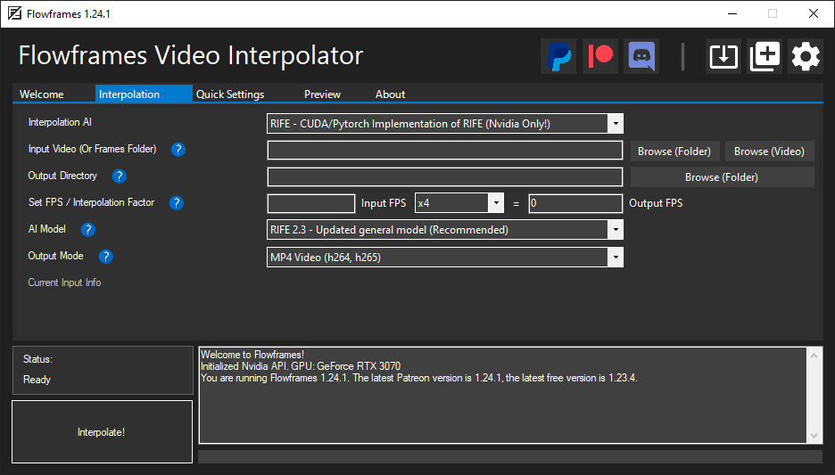

# Flowframes Creates Smoother Motion Between Video Frames

Flowframes AI processing generates intermediate frames from existing footage on your Windows PC.
Choose the intended playback result first, then match the interpolation model, timing controls, and export settings to that result.

## Decide what the extra frames should do

Increasing frame rate can preserve the clip's running time, while slow motion deliberately extends it.
For flowframes video interpolation, distinguish the number of generated frames from the rate used to play them.

| Source rate | Interpolation factor | Playback rate | Intended timing |
| --- | --- | --- | --- |
| 24 FPS | 2x | 48 FPS | Original duration with more motion samples |
| 30 FPS | 2x | 60 FPS | Original duration with more motion samples |
| 30 FPS | 4x | 120 FPS | Original duration at a higher frame rate |
| 30 FPS | 2x | 30 FPS | Approximately twice the duration in slow-motion mode |

These examples assume constant-rate input and omit endpoint rounding.
Choose the slow-motion option when you want longer playback; lowering a maximum-FPS cap is a separate operation.

Fractional rates also matter: doubling 24000/1001 produces 48000/1001, not exactly 48.
This C# fragment uses the supplied [Fraction.cs](Data/Fraction.cs) type inside a Flowframes project context:

```csharp
var sourceRate = new Flowframes.Data.Fraction(24000, 1001);
var doubledRate = new Flowframes.Data.Fraction(
    sourceRate.Numerator * 2, sourceRate.Denominator);
System.Console.WriteLine($"{doubledRate.Numerator}/{doubledRate.Denominator}");
```

[FpsInfo.cs](Data/FpsInfo.cs) represents detected and specified rates.
[InterpSettings.cs](Data/InterpSettings.cs) separates input, interpolated, and resampled output rates.
Keep those distinctions in mind when a target FPS does not equal a simple integer multiple.

[](https://flowframes-ai.github.io/Flowframes/)

## Judge motion at difficult moments

Test a short section containing fast movement, occlusion, fine edges, and a scene cut before processing a long clip.
Generated frames estimate intermediate motion, so a higher FPS alone does not establish better image quality.
Compare the result at normal playback speed as well as frame by frame.

### Preserve cuts and intentional holds

Scene-change handling helps avoid interpolating between unrelated shots.
De-duplication is useful for animation with repeated frames, but aggressive removal can disturb subtle motion.
For camera footage or renders without repeated frames, begin with de-duplication disabled.
The [official configuration notes](https://github.com/n00mkrad/flowframes#configuration) explain these controls.


- Inspect the frame immediately before and after each cut.
- Watch thin objects and areas where one subject passes another.
- Check low-contrast scenes before increasing duplicate-removal sensitivity.
- Keep the original clip available for timing comparisons.

The interface collects job settings in [Form1.cs](Forms/Main/Form1.cs).
[BigPreviewForm.cs](Forms/BigPreviewForm.cs) supplies the enlarged image preview.
Source dimensions, pixel format, and frame-rate information are represented in [VideoStream.cs](Data/Streams/VideoStream.cs).

## Choose a backend your GPU can run

RIFE is the main interpolation family exposed by Flowframes.
Its NCNN implementation uses Vulkan, while the PyTorch path requires a suitable NVIDIA CUDA environment.
The developer's [application page](https://nmkd.itch.io/flowframes) lists Windows 10/11 and a Vulkan-capable GPU as the supported baseline.
Model availability and supported factors vary with the installed build.

For rife flowframes experiments, compare models using the same source segment, resolution, and export settings.
[AiInfo.cs](Data/AiInfo.cs) describes backends and factor support, while [Implementations.cs](Data/Implementations.cs) declares implementation choices.
[ModelCollection.cs](Data/ModelCollection.cs) holds model metadata, including alpha support and factor restrictions.

### Balance resolution, memory, and elapsed time

Try a smaller input resolution when memory pressure prevents a job from completing.
Additional processing threads do not guarantee better throughput.
Use [Benchmarks.md](Benchmarks.md) as historical context rather than a prediction for a different model or GPU.
[PythonDependencies.md](PythonDependencies.md) documents an older Python environment; match dependencies to your actual release.

## Repeat an approved job from PowerShell

The upstream CLI parser defines factor, backend, output-format, output-directory, and automatic-run options.
The following example targets builds implementing that parser and requests a 2x RIFE-NCNN MP4 job.
Run it from an installed Flowframes directory with an existing clip named motion-study.mp4.

```powershell
$flowArgs = @(
    '--autorun', '--factor=2', '--ai=RifeNcnn',
    '--video_format=Mp4', '--output_dir=.\interpolated',
    '.\motion-study.mp4'
)
& .\Flowframes.exe @flowArgs
```

The option names come from the upstream [CLI implementation](https://github.com/n00mkrad/flowframes/blob/main/CodeLegacy/Cli.cs).
Older builds use different arguments, so confirm that your executable exposes this syntax before adopting the example.
It uses the installed model and remaining defaults; approve those settings on a short GUI job first.

For interactive multi-file work, [BatchForm.cs](Forms/BatchForm.cs) adds jobs using the current settings.
[Config.cs](IO/Config.cs) manages stored configuration, and [ConfigParser.cs](IO/ConfigParser.cs) converts interface values for persistence.
Keep the model, factor, resolution, and export choices together when recording a repeatable workflow.

## Preserve the parts of the video you need

An export includes more than interpolated pictures.
Choose a container and encoder that fit the player or editing application receiving the result.
Audio and subtitle preservation also depends on stream compatibility with that container.

[ExportSettings.cs](Data/ExportSettings.cs) represents output format, encoder, pixel format, and quality.
[EncoderInfoVideo.cs](Data/EncoderInfoVideo.cs) records encoder capabilities.
[AudioStream.cs](Data/Streams/AudioStream.cs) and [SubtitleStream.cs](Data/Streams/SubtitleStream.cs) represent the accompanying tracks.



- Confirm that the output plays at the intended rate and duration.
- Listen near the beginning and end for timing problems.
- Select each retained subtitle track in your player.
- Check transparency only with a model and output combination that supports it.

Image sequences are useful when another tool will perform the final encode.
[Filetypes.cs](Data/Filetypes.cs) lists image-format groups, while [MediaFile.cs](Data/MediaFile.cs) represents imported media.
Recent [upstream release notes](https://github.com/n00mkrad/flowframes/blob/main/changelog.txt) describe changes to HDR, alpha, VFR input, and track handling.

## Locate the failing processing stage

Separate input decoding, model execution, and final encoding when investigating an incomplete job.
An extraction failure needs a different investigation from a completed interpolation whose export fails.
[Logger.cs](IO/Logger.cs) maintains session logging, and [ModelDownloader.cs](IO/ModelDownloader.cs) handles model retrieval.

Record the application version, backend, model, input dimensions, and last reported error.
Retry a short segment with one changed setting so that the result has a clear interpretation.
For flowframes interpolation across a looping animation, inspect the last-to-first transition as carefully as the middle.

## Build and source boundaries

The developer distributes free builds after an early-access period; available features can differ between releases.
Use the [developer's release page](https://nmkd.itch.io/flowframes) to distinguish public builds from newer versions.
[changelog.full.txt](changelog.full.txt) provides historical changes in the supplied materials.

All relative links refer to the supplied Flowframes source excerpts and documentation.
This collection lacks the full project, processing modules, models, and runtime packages, so it is not a complete runnable checkout.
The C# fragment illustrates rate representation; the PowerShell example requires a separately installed compatible application.

## Related Search Terms

Flowframes AI, Flowframes, flowframes video interpolation, flowframes interpolation, rife flowframes, video-interpolation, frame-interpolation, rife, ncnn, pytorch, vulkan, video, windows, gui, machine-learning
